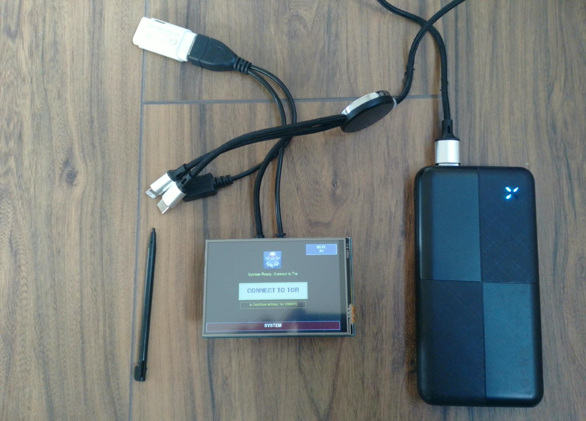
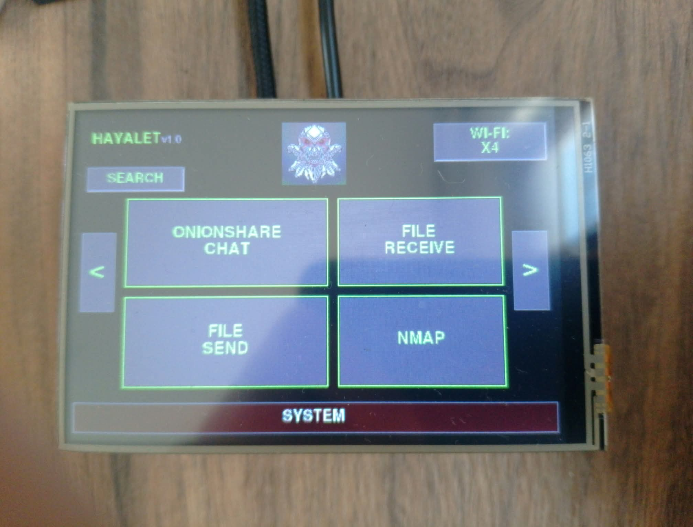
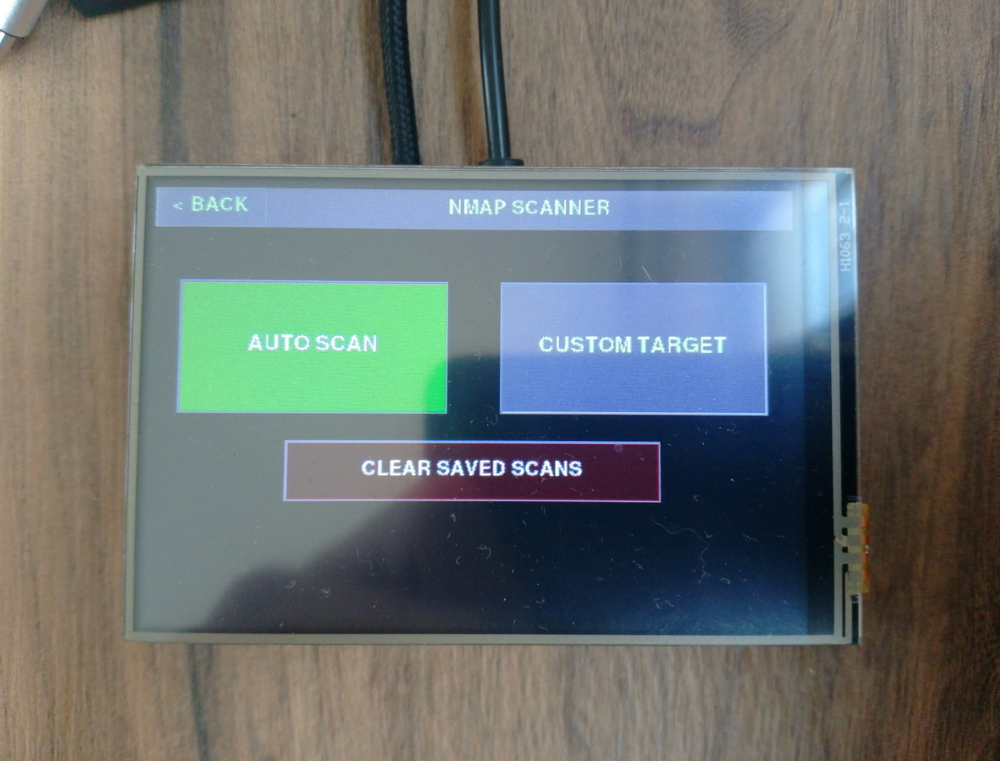
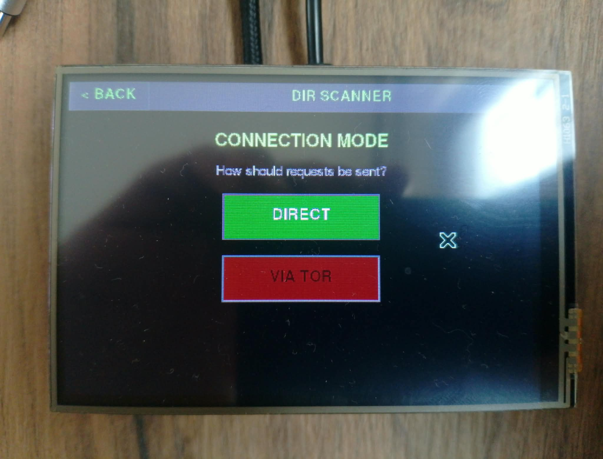
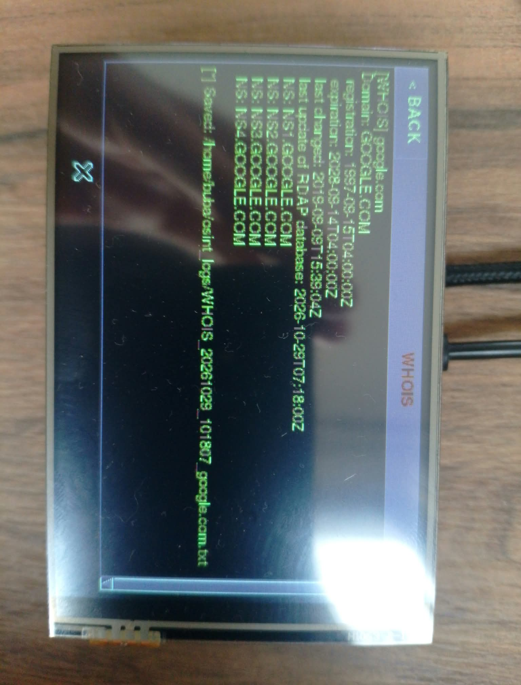
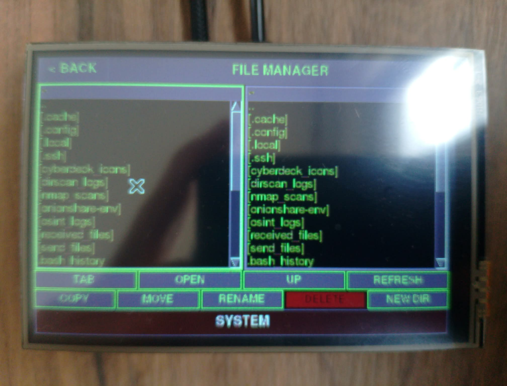
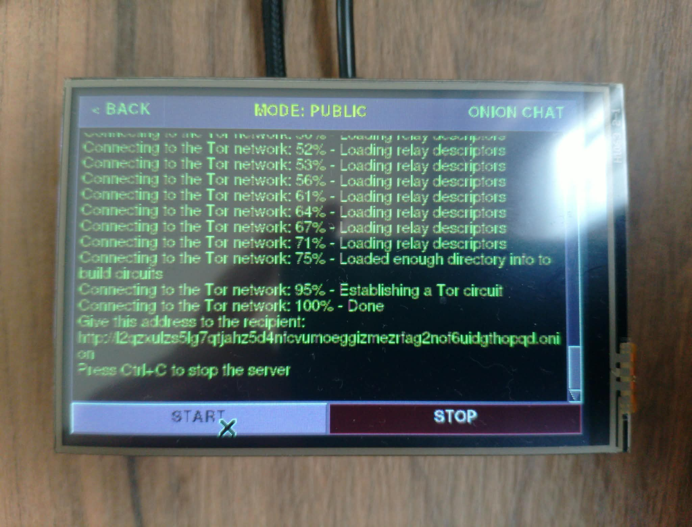
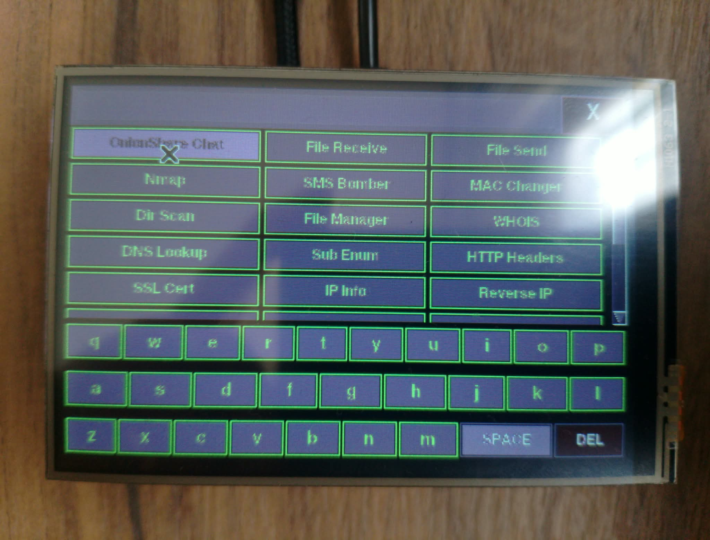

# 👻 HAYALET v1.0

**A touchscreen-enabled, Tor-powered anonymous OSINT cyberdeck for Raspberry Pi Zero 2W.**

A small, portable, palm-sized cyber reconnaissance tool. OnionShare, Nmap, 13 OSINT tools, a dual-pane file manager, and much more in a single Tkinter interface.

[](https://www.gnu.org/licenses/gpl-3.0.html)
[](https://www.python.org/)
[](https://www.raspberrypi.com/)

---

## 📸 Gallery

<table>
  <tr>
    <td align="center"><b>Boot Screen</b><br></td>
    <td align="center"><b>Main Menu</b><br></td>
  </tr>
  <tr>
    <td align="center"><b>Nmap Scanner</b><br></td>
    <td align="center"><b>Dir Scanner</b><br></td>
  </tr>
  <tr>
    <td align="center"><b>WHOIS (OSINT)</b><br></td>
    <td align="center"><b>File Manager</b><br></td>
  </tr>
  <tr>
    <td align="center"><b>OnionShare Chat</b><br></td>
    <td align="center"><b>Quick Launcher</b><br></td>
  </tr>
</table>

> **Note:** All screenshots are located in the `screenshots/` folder.

---

## ✨ Features

### 🔐 Anonymity
- **Tor Integration** — Automatic `torrc` configuration (ControlPort, TransPort, DNSPort)
- **IP Rotation** — Automatic circuit renewal every N requests (`NEWNYM`)
- **Tor-less Mode** — Risky but fast, via "Continue without Tor"
- **SOCKS5 Proxy** — All OSINT tools route through `socks5h://127.0.0.1:9050`

### 🌐 Network Tools
- **Nmap Scanner** — 12 scan modes
- **Device Discovery** — Automatic network sweep (hostname + IP resolution)
- **Dir Scanner** — Baseline detection with false-positive filtering
- **Wi-Fi Management** — Scan SSIDs, connect, view passwords

### 🔍 OSINT (13 Tools)
| Tool | Description |
|---|---|
| WHOIS | Domain registration info (RDAP) |
| DNS Lookup | A, AAAA, MX, TXT, NS, CNAME records |
| Sub Enum | Subdomain discovery via crt.sh |
| HTTP Headers | Server headers |
| SSL Cert | Certificate history |
| IP Info | Geo + ISP info |
| Reverse IP | Domains sharing the same IP |
| Tech Stack | Framework/CMS fingerprinting |
| Wayback | Archive snapshots |
| Robots.txt | Hidden paths |
| Sitemap.xml | Site map |
| Sec Headers | 6 security header checks |
| Port Check | Single port probe (over Tor) |

### 🧅 OnionShare
- Onion Chat, File Receive, File Send
- PUBLIC/PRIVATE mode support
- `.onion` address automatically saved to file

### 🗂️ File Management
- **Dual-Pane File Manager** — Norton Commander style
- **Auto USB Detection**
- Copy, Move, Rename, Delete, New Folder

### 🛠️ Utility Tools
- MAC Changer, Analog Clock, Calculator, Speedtest, Snake

### 🎨 Interface
- Optimized for 480×320 touchscreen
- On-screen keyboards (Wi-Fi, Nmap, File Manager, Search)
- **Quick Launcher** — Search across 26 features via SEARCH button
- 500-line log limit (RAM-friendly)
- Fullscreen (kiosk) mode
- **CLR LOGS** — One-tap log cleanup for OSINT, DirScan, and Nmap

---

## 🖥️ Hardware Requirements

| Component | Minimum | Recommended |
|---|---|---|
| **SBC** | Raspberry Pi Zero 2W | Raspberry Pi 4 (2GB+) |
| **RAM** | 512 MB (with zram) | 1 GB+ |
| **Storage** | 8 GB USB flash | 16 GB+ USB flash |
| **Display** | 3.5" TFT (480×320) | 5" HDMI touchscreen |
| **OS** | Raspberry Pi OS 64-bit Lite | Kali ARM / Debian |

**Platform Note:** This project is designed for Linux (Raspberry Pi OS / Debian). If you run it on macOS or Windows, only the OSINT tools, Clock, Calculator, and Snake will work. Features depending on Linux commands (Wi-Fi management, MAC Changer, Nmap) will not function.

---

## 🚀 Quick Install (Recommended)

Fully automated script. **PEP 668 compliant** — does not break system Python, installs all packages via `apt`:

```bash
git clone https://github.com/AlperenBuba/HAYALET.git
cd HAYALET
chmod +x install.sh
./install.sh
python3 cyberdeck.py
```

`install.sh` does the following:
- Installs system packages (`tor`, `nmap`, `python3-tk`, `xserver-xorg`, etc.)
- Installs Python dependencies via `apt` (PEP 668-safe)
- Creates OnionShare venv at `~/onionshare-env`
- Configures Tor
- Creates required directories
- Auto-generates `.env`
- Enables zram (with lzo fallback if lz4 fails)
- Sets up kiosk mode (`.xinitrc` + `.bash_profile`)
- Auto-fixes legacy paths in `cyberdeck.py`

**If something breaks:** run `./check_deps.sh` to identify missing dependencies.

---

## 📦 Manual Installation

### 1. Operating System

**Raspberry Pi OS 64-bit Lite** (recommended):

```bash
# Flash to SD/USB with Raspberry Pi Imager
# On first boot: sudo raspi-config → Expand Filesystem
```

**Display driver** (for 3.5" TFT):

```bash
git clone https://github.com/goodtft/LCD-show.git
cd LCD-show
sudo ./LCD35-show
sudo reboot
```

### 2. System Packages

```bash
sudo apt update
sudo apt install -y \
    python3 python3-pip python3-tk python3-venv \
    python3-pil python3-pil.imagetk \
    tor proxychains4 nmap network-manager wireless-tools \
    curl git speedtest-cli zram-tools \
    xserver-xorg xinit x11-xserver-utils unclutter
```

### 3. Python Dependencies

> ⚠️ **PEP 668 Warning:** On Raspberry Pi OS Bookworm/Trixie, `pip3 install` writes to system Python and fails with `externally-managed-environment`. Install packages via `apt`:

```bash
sudo apt install -y \
    python3-pil python3-pil.imagetk \
    python3-requests python3-socks \
    python3-stem python3-dotenv
```

Alternative: `pip3 install --break-system-packages -r requirements.txt` (not recommended, may break your system).

### 4. OnionShare

```bash
# In home directory (portable)
python3 -m venv ~/onionshare-env
~/onionshare-env/bin/pip install --upgrade pip
~/onionshare-env/bin/pip install onionshare-cli
```

**Note:** `install.sh` creates this folder in the home directory (`~/onionshare-env`). The `.env` file points to this path.

### 5. Tor Configuration

```bash
sudo nano /etc/tor/torrc
```

Make sure the following lines are uncommented:

```
ControlPort 9051
CookieAuthentication 1
TransPort 9040
DNSPort 5353
VirtualAddrNetworkIPv4 10.192.0.0/10
AutomapHostsOnResolve 1
```

Then:

```bash
sudo systemctl enable tor
sudo systemctl restart tor
sudo systemctl status tor
```

### 6. Directory Structure

```bash
mkdir -p ~/cyberdeck_icons ~/wordlists ~/nmap_scans
mkdir -p ~/dirscan_logs ~/osint_logs
mkdir -p ~/received_files ~/send_files ~/downloads
```

Add `ghost.jpg` inside **`~/cyberdeck_icons/`** (for the logo).

You can add wordlists inside **`~/wordlists/`**.

### 7. Configuration (.env)

When you run `install.sh`, a `.env` file is automatically created in the project directory:

```env
ONIONSHARE_CLI=/home/user/onionshare-env/bin/onionshare-cli
RECEIVE_DIR=/home/user/received_files
SEND_DIR=/home/user/send_files
ICON_DIR=/home/user/cyberdeck_icons
```

Edit this file if you want to change paths. `.env` is `.gitignore`d and will not be committed.

**For manual installs**, copy `.env.example`:

```bash
cp .env.example .env
nano .env  # edit paths as needed
```

### 8. Run

```bash
python3 cyberdeck.py
```

---

## 📖 Usage Guide

### 🎬 Boot Screen


On launch, the **Boot Screen** appears:

- **👻 Ghost logo** — Rotating animation in the center
- **WI-FI** — Top right, shows current SSID
- **CONNECT TO TOR** — Starts and verifies Tor (recommended)
- **⚠ Continue without Tor** — Proceed without Tor (risky)
- **SYSTEM** — Red button at the bottom (shutdown menu)

**Tip:** In normal use, start with **CONNECT TO TOR**. It waits up to 30-60 seconds before redirecting to the main menu.

---

### 🏠 Main Menu


The main menu has **6 pages**:

- **Right arrow (›)** — Next page
- **Left arrow (‹)** — Previous page
- **SEARCH** — Quick search (26 features)
- **WI-FI** — Wi-Fi management
- **HAYALET v1.0** — Version info (top-left)
- **SYSTEM** — Red button at the bottom

#### Page Layout

| Page | Buttons |
|---|---|
| **1** | OnionShare Chat, File Receive, File Send, Nmap |
| **2** | SMS Bomber*, MAC Changer, Dir Scan, WHOIS |
| **3** | DNS, Sub Enum, HTTP Headers, SSL Cert |
| **4** | IP Info, Reverse IP, Tech Stack, Wayback |
| **5** | Robots.txt, Sitemap.xml, Sec Headers, Port Check |
| **6** | File Manager, Clock, Calculator, Speedtest, Snake |

*SMS Bomber is disabled by default (`ENABLE_SMS_BOMBER = False`).

---

### 🔍 Quick Launcher (SEARCH)


Tap **SEARCH** → full-screen search opens:

1. **Top:** Search box
2. **Middle:** Filtered app grid
3. **Bottom:** On-screen keyboard (qwerty)

**How to use:**
- Type `who` → only **WHOIS** remains
- Tap a button → go to that page
- **X** → close search
- **SPACE / DEL** → space and backspace

Search across 26 features with one tap.

---

### 🌐 Nmap Scanner


**Step 1: Pick Target**
- **AUTO SCAN** — Automatically scans the whole subnet (`192.168.1.0/24`)
- **CUSTOM TARGET** — Manually enter IP or pick a device
- **CLEAR SAVED SCANS** — Delete old scans (`~/nmap_scans/`)

**Step 2: Pick Scan Mode** (12 modes)

| Mode | Command | Use Case |
|---|---|---|
| **INTENSE** | `-A -T4` | Detailed scan |
| **ALL PORTS** | `-p- -T4` | All ports (slow) |
| **VULN** | `--script vuln` | Vulnerability scan |
| **STEALTH** | `-sS -T2 -f` | Stealth scan |
| **QUICK** | `-F -T4` | Fast (top 100) |
| **OS+VER** | `-sV -O` | OS + service detection |
| **PING** | `-sn` | Ping only |
| **UDP** | `-sU --top 50` | UDP ports |
| **TRACEROUTE** | `--traceroute` | Route tracing |
| **DFLT SCRIPTS** | `-sC` | Default scripts |
| **ARP SCAN** | `-sn -PR` | ARP scan |
| **EVASION** | `-f -T2` | IDS evasion |

**Output:** `~/nmap_scans/nmap_YYYYMMDD_HHMMSS_mod.txt` — one file per scan.

---

### 🔎 Dir Scanner


**4-Step Wizard:**

1. **Enter URL** — `http://example.com` (or just `example.com`)
2. **Pick Mode** — QUICK (150 words) or WORDLIST (choose a file)
3. **Pick Connection** — DIRECT (fast) or VIA TOR (anonymous)
4. **Watch Results**

**Wordlist Sources:**
- `~/wordlists/`
- `/usr/share/wordlists/` (Kali)
- `./wordlists/` (project dir)

**Baseline Detection:** If the server returns `200` for all paths, a size filter removes false positives.

**Logs:** `~/dirscan_logs/YYYYMMDD_HHMMSS_domain.txt`

---

### 🔍 OSINT Tools (13 total)

All OSINT tools share the same layout:


**Each tool has:**
- **Target input** — Domain, IP, or URL
- **RUN** — Start the query
- **CLEAR** — Clear input
- **NEW ID** — Renew Tor circuit (new IP)
- **CLR LOGS** — Delete this tool's logs (top-right)
- **On-screen keyboard** — 4 rows (digits + letters + special chars)

**Output:** `~/osint_logs/{TOOL}_{date}_{target}.txt`

#### Tool Descriptions

- **WHOIS** → Domain owner, registration/expiry, nameservers
- **DNS Lookup** → A, AAAA, MX, TXT, NS, CNAME records
- **Sub Enum** → All subdomains via crt.sh
- **HTTP Headers** → Server, X-Powered-By, Set-Cookie
- **SSL Cert** → Certificate history, issuer, subject
- **IP Info** → Country, city, ISP, ASN, coordinates
- **Reverse IP** → Domains on the same IP
- **Tech Stack** → WordPress, Nginx, PHP, jQuery detection
- **Wayback** → Latest archive date + URL
- **Robots.txt** → Disallow rules (hidden paths)
- **Sitemap.xml** → All URLs (SEO map)
- **Sec Headers** → 6 security header checks
- **Port Check** → Port OPEN / CLOSED (over Tor)

---

### 🗑️ Log Cleanup (CLR LOGS)

OSINT tools, **Dir Scan**, and **AI Chat** pages show a red **CLR LOGS** button in the top-right.

**How it works:**
1. Tap the button → confirmation dialog opens
2. Shows file count and total size
3. **YES, DELETE** → clears `~/osint_logs/`, `~/dirscan_logs/`, or `~/ai_logs/`
4. **CANCEL** or tap outside → abort

**For Nmap:** same action via **CLEAR SAVED SCANS** button (`~/nmap_scans/`).

**Note:** Only `.txt` files are deleted. Subdirectories and other extensions are preserved.

---

### 🧅 OnionShare


3 modes:

**1. Onion Chat**
- Tap → choose PUBLIC/PRIVATE
- **START** → creates a chat room over Tor
- `.onion` address saved to `~/onionshare_chat.txt`

**2. File Receive**
- Receive files over Tor
- Files downloaded to `~/received_files/`

**3. File Send**
- Share files from `~/send_files/`
- If empty: "Empty dir!" warning

**PUBLIC vs PRIVATE:**
- **PUBLIC** — Anyone with the `.onion` address can connect
- **PRIVATE** — Invite only (requires a private key)

---

### 🗂️ File Manager


**Dual-pane** (Norton Commander style):

- **Left panel** — USB drive (auto-detected)
- **Right panel** — Home directory (`~`)
- **Active panel** — Green border

**Controls:**
- **TAB** — Switch panels
- **OPEN** — Open file/folder
- **UP** — Go to parent directory
- **REFRESH** — Reload
- **COPY** — Copy to the other panel
- **MOVE** — Move to the other panel
- **RENAME** — Rename
- **DELETE** — Delete (with confirmation)
- **NEW DIR** — New folder

**Return to USB:** tap the yellow path label at the top.

---

### 📶 Wi-Fi Management

Tap **WI-FI** on the boot screen or main menu:

- **Network list** — SSID + signal % + security
- **Tap a network** — Enter password (on-screen keyboard)
- **CONNECT** — Connect
- **DISCONNECT** — Drop connection
- **SCAN NETWORKS** — Rescan

**Connected Network Info:** SSID + password shown on screen.

---

### 🎮 Utility Tools

- **MAC Changer** — Random MAC applied to `wlan0` (Wi-Fi drops for 3-5 seconds)
- **Clock** — Analog clock + digital time
- **Calculator** — Normal / Scientific / Programmer (HEX/DEC/OCT/BIN)
- **Speedtest** — Speed test via `speedtest-cli`
- **Snake** — Touch-controlled classic Snake game

---

## 🐛 Troubleshooting

### Quick Check

```bash
./check_deps.sh
```

Shows missing dependencies.

### Common Issues

| Problem | Solution |
|---|---|
| `ModuleNotFoundError: No module named 'PIL'` | `sudo apt install python3-pil` |
| `externally-managed-environment` | Use `sudo apt install python3-xyz` instead of `pip3` |
| `Tor not running` | `sudo systemctl start tor` |
| `Permission denied: nmap` | `sudo -v` (enter password once) |
| OnionShare page empty | `ls ~/onionshare-env/bin/onionshare-cli` |
| Wi-Fi list empty | `nmcli device status` |
| Screen freezes | `free -h` → check zram |
| `socks5h` not connecting | `curl --socks5-hostname 127.0.0.1:9050 ifconfig.me` |
| `ghost.jpg` not visible | `~/cyberdeck_icons/ghost.jpg` present? |
| App won't launch | Check `python3 cyberdeck.py` output |

### Screen Won't Turn On / Black Screen (Headless / Kiosk)

If the app doesn't auto-start:

1. **Is Console Autologin enabled?**
   ```bash
   sudo raspi-config
   # System Options → Boot / Auto Login → Console Autologin
   ```

2. **Is `.xinitrc` correct?**
   ```bash
   cat ~/.xinitrc
   # should contain: exec python3 /home/<user>/HAYALET/cyberdeck.py
   ```

3. **Manual test:**
   ```bash
   startx
   # read any error output, or the app launches
   ```

4. **TFT display driver:**
   ```bash
   sudo nano /boot/firmware/config.txt
   # add dtoverlay=tft35a:rotate=90 (adjust for your display)
   ```

### Enabling zram

```bash
sudo apt install -y zram-tools
# if lz4 fails, use lzo:
sudo sed -i 's/^ALGO=lz4/ALGO=lzo/' /etc/default/zramswap
sudo systemctl enable --now zramswap
```

### Log Cleanup

```bash
# Fast CLI cleanup (CLR LOGS buttons inside the app also work)
rm -rf ~/osint_logs/* ~/nmap_scans/* ~/dirscan_logs/*
```

### Is `.env` Committed to Git?

```bash
git check-ignore .env
# prints .env if correctly ignored
# prints nothing if not — add it to .gitignore
```

`.gitignore` should contain:

```
.env
.env.*
onionshare-env/
__pycache__/
*.pyc
```

---

## 📁 Project Structure

```
HAYALET/
├── cyberdeck.py          # Main application (~2900 lines)
├── requirements.txt      # Python deps (reference for manual/venv install)
├── install.sh            # Automated installer
├── check_deps.sh         # Dependency checker
├── .env.example          # .env template
├── README.md             # This file
├── LICENSE               # GPL v3
├── .gitignore            # Git ignore rules
└── screenshots/          # Screenshots
    ├── boot.jpeg
    ├── menu.jpeg
    ├── nmap.jpeg
    ├── dirscan.jpeg
    ├── whois.jpeg
    ├── filemanager.jpeg
    ├── onionchat.jpeg
    └── search.jpeg
```

In the user's home directory:

```
~/onionshare-env/        # OnionShare venv (in home directory)
~/cyberdeck_icons/       # Ghost logo
~/wordlists/             # Wordlists
~/nmap_scans/            # Nmap outputs
~/dirscan_logs/          # Dir Scan outputs
~/osint_logs/            # OSINT outputs
~/received_files/        # OnionShare received files
~/send_files/            # OnionShare sent files
```

---

## 🔧 Taking Screenshots

On the Pi:

```bash
sudo apt install -y scrot
mkdir -p ~/HAYALET/screenshots

# Capture
scrot -o ~/HAYALET/screenshots/boot.jpeg
scrot -o ~/HAYALET/screenshots/menu.jpeg
scrot -o ~/HAYALET/screenshots/nmap.jpeg
scrot -o ~/HAYALET/screenshots/dirscan.jpeg
scrot -o ~/HAYALET/screenshots/whois.jpeg
scrot -o ~/HAYALET/screenshots/filemanager.jpeg
scrot -o ~/HAYALET/screenshots/onionchat.jpeg
scrot -o ~/HAYALET/screenshots/search.jpeg
```

Or with `import` (ImageMagick):

```bash
import -window root ~/HAYALET/screenshots/boot.jpeg
```

---

## 🤝 Contributing

1. Fork it
2. Create a feature branch (`git checkout -b feature/new-feature`)
3. Commit (`git commit -m 'New feature: ...'`)
4. Push (`git push origin feature/new-feature`)
5. Open a Pull Request

**Code style:** PEP 8 compliant, meaningful variable names.

---

## 📄 License

This project is licensed under the **GNU General Public License v3.0**.

[](https://www.gnu.org/licenses/gpl-3.0.html)

See the [LICENSE](LICENSE) file for details.

**Summary:** You may use, modify, and distribute this code. However, derivative works must also be shared under **GPL v3** and as **open source**. You may not use it in a closed-source commercial product.

**How GPL v3 differs from v2:**
- **Patent protection** — Contributors automatically grant patent rights
- **Anti-tivoization** — Hardware vendors cannot lock down GPL software
- **DRM prevention** — Users retain the right to modify software
- **Apache 2.0 compatible** — Can be combined with Apache 2.0 licensed code

---

## ⚠️ Legal Notice

This project is intended for **educational and personal use**. Only use it against:

- **Your own** servers
- Targets for which you have **legal permission**
- **CTF competitions**
- **Bug bounty programs** (read the scope first)

**Unauthorized scanning** is a criminal offense in Türkiye under **TCK 243** (accessing information systems) and **TCK 244** (disrupting information systems).

**Using Tor** does not eliminate legal responsibility. It only conceals your technical trail, not your **legal liability**.

Any legal responsibility arising from the use of this code rests solely with the **user**.

---

## 🙏 Credits

- **Melisa** — Soldering work
- **Raspberry Pi Foundation** — Hardware
- **Tor Project** — Anonymity infrastructure
- **OnionShare** — Secure file sharing
- **Nmap** — Network scanning
- **crt.sh, rdap.org, ip-api.com, ipwho.is** — OSINT APIs
- **The entire open-source community**

---

**⭐ If you like this project, give it a star!**